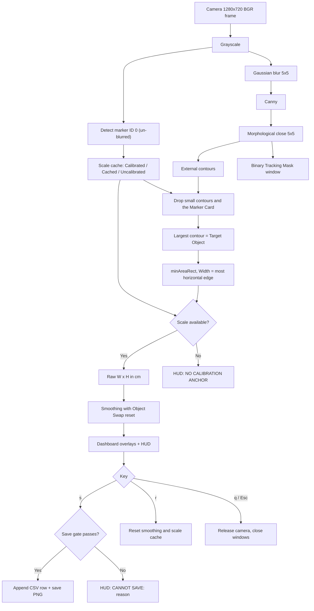

# Product Requirements Document (PRD)
# Monocular Object Measurement Engine Prototype

Terminology follows [GLOSSARY.md](GLOSSARY.md).

---

## 1. Document Control

| Field | Detail |
| :--- | :--- |
| **Project Title** | Monocular Object Measurement Engine Prototype |
| **Lead Engineer** | Shawn Shaibu Cherian (`26BCE1820`) |
| **Document Version** | `1.1.0` |
| **Document Status** | Approved Engineering Specification |
| **Target Runtime** | macOS / Apple Silicon (M-series) |
| **Primary Sensor** | Built-in FaceTime HD camera, camera index 0, captured at 1280×720 @ 30 FPS |
| **Core Stack** | Python 3.11+, `opencv-python` ≥ 4.7 (includes `cv2.aruco.ArucoDetector`), NumPy, pytest |

---

## 2. Executive Summary & Problem Statement

Manually measuring packages and cartons is slow and error-prone in warehousing, postal logistics and e-commerce fulfilment. Automated dimensioners use stereo camera arrays, LiDAR or depth (RGB-D) cameras, which are expensive and need dedicated rigs.

This prototype measures the **front face of a rigid object** (Width × Height, in centimetres) in real time using **one ordinary webcam** and a **printed Reference Marker** of known size placed on the same plane as the object's front face. The marker gives a per-frame Scale Factor (cm per pixel); robust outline extraction then gives the object's size.

The prototype is the algorithmic foundation for the team's later multidisciplinary project; it measures objects only.

---

## 3. Goals & Non-Goals

### 3.1 Goals
- **G1 – Stream ingestion**: Capture the built-in camera at **1280×720 @ 30 FPS** and process every frame live.
- **G2 – Dynamic scale**: Detect Reference Marker ID 0 (`DICT_4X4_50`, 5.0 cm × 5.0 cm) each frame and derive the Scale Factor.
- **G3 – Texture-immune outline**: Find the object's outer outline while ignoring barcodes, labels, print and seams on its surface.
- **G4 – Rotation-invariant size**: Fit a minimum-area rotated rectangle to the outline and report Width × Height in cm.
- **G5 – Stable readout**: Smooth readings so the display is steady within ±0.5 cm, and restart smoothing automatically on an Object Swap.
- **G6 – Dual-window display**: Measurement Dashboard (colour + overlays) and Binary Tracking Mask (diagnostic).
- **G7 – Tuning & logging**: Live trackbars for detection thresholds; `s` saves a validated Snapshot (CSV row + PNG).

### 3.2 Non-Goals
- **NG1 – Human body measurement / pose estimation.** Rigid objects only.
- **NG2 – Depth / volume.** Only the front face (2D) is measured.
- **NG3 – Angled views / homography un-warping.** The setup mandates Perpendicular Alignment.
- **NG4 – Multi-camera triangulation.**
- **NG5 – Lens distortion calibration.** Instead, measurements are only accepted inside the central Guide Box, where distortion is smallest. Checkerboard calibration is future work.
- **NG6 – Four-marker calibration board.** With a perpendicular camera, a board of corner markers would stand behind the object, not on its front face, violating the Co-Planar Rule. Future work if the setup ever moves to a top-down view.
- **NG7 – Measuring more than one object at a time.** Only the largest valid outline is measured.

---

## 4. Physical & Optical Constraints

```
                     Top-down view of the bench

                          [ Laptop webcam ]
                                 |
                                 |  optical axis, perpendicular
                                 v  to the measurement plane
              ===========================================  <- Measurement Plane
              |  [Marker]        [ Target Object front ] |
              ===========================================
                  ^ same distance from the camera ^
```

1. **Perpendicular Alignment**: the camera's optical axis is at 90° ± 2° to the object's front face.
2. **Co-Planar Rule (critical)**: the marker is at the same distance from the camera as the front face. Two placements are supported:
   - **Taped on the front face** of the object.
   - **On a flush stand beside the object** (a Marker Card), aligned with the front face.

   A marker offset in depth by ΔZ at camera distance Z causes a scale error of roughly ΔZ/Z.
3. **Minimum object size**: the front face must be **larger than 75 cm²** (3 × the 25 cm² marker area) so it can be told apart from a Marker Card.
4. **Guide Box**: the object and marker must lie inside the central 70% of the frame (lens distortion grows towards the edges).
5. **Backdrop & lighting**: a uniform, matte backdrop that contrasts with the object; diffuse light (≥ 300 lux) to avoid hard shadows that read as edges.
6. **Printing the marker**: print the supplied marker image at 100% scale and verify with a ruler that the black square is exactly 5.0 cm.

---

## 5. Algorithms

### 5.1 Marker detection & Scale Factor
Detection runs on the **un-blurred grayscale frame** (blurring degrades corner precision, and scale depends directly on the corners). Only marker **ID 0** is used; other markers are ignored.

For corners $\mathbf{p}_0..\mathbf{p}_3$:

$$P_{\text{px}} = \sum_{i=0}^{3} \lVert \mathbf{p}_{(i+1)\bmod 4} - \mathbf{p}_i \rVert_2, \qquad S_t = \frac{4 \times 5.0\ \text{cm}}{P_{\text{px}}}$$

#### Scale caching
$$S_{\text{active}} = \begin{cases}
S_t & \text{marker seen (age} = 0\text{): Calibrated} \\
S_{\text{last}} & \text{marker missing, age} \le 30\text{: Cached} \\
\text{none} & \text{marker missing, age} > 30\text{: Uncalibrated}
\end{cases}$$

### 5.2 Outline segmentation
1. Grayscale → Gaussian blur, 5×5, σ = 1.0.
2. Canny edges with tunable thresholds (defaults 50 / 150).
3. Morphological closing with a 5×5 rectangular kernel to join gaps in the outer outline.
4. External contours only (`RETR_EXTERNAL`), so outlines nested inside the object (labels, barcodes, a taped-on marker) are discarded.
5. Filtering:
   - drop contours with area < $A_{\min}$ (default 2000 px);
   - **Marker Card rule**: drop a contour if it contains the marker centre **and** its area is < 3 × the marker's pixel area. (A box with the marker taped on contains the centre but is much larger, so it is kept.) When the marker is momentarily hidden, the last seen marker position is used.
6. The Target Object is the largest remaining contour.

### 5.3 Width × Height
$\mathcal{R} = \text{minAreaRect}(C)$, vertices from `boxPoints`. Of the two adjacent edges, **Width is the edge closest to horizontal** and Height is the other. This does not depend on OpenCV's rectangle-angle convention (which changed in 4.5.1). At exactly 45° the two labels are interchangeable.

$$W^{\text{raw}} = w_{\text{px}} \cdot S_{\text{active}}, \qquad H^{\text{raw}} = h_{\text{px}} \cdot S_{\text{active}}$$

### 5.4 Smoothing & Object Swap
$$W_t = \alpha W_t^{\text{raw}} + (1-\alpha) W_{t-1}\quad(\text{same for } H), \qquad \alpha = 0.2$$

α is tunable 0.1–1.0. At α = 0.2 and 30 FPS the readout settles within ~0.5 s (95% after ≈ 14 frames).

Reset rules:
- **Object Swap**: if raw W or H differs from the smoothed value by more than **15%** for **5 consecutive frames**, smoothing restarts from the raw value.
- **Object lost**: after **15 consecutive frames** without a measurement, smoothing state is cleared. Before that, the last value is shown dimmed.
- **Manual**: `r` resets smoothing and the scale cache.

---

## 6. Processing Pipeline



---

## 7. User Interface, Controls & Logging

### 7.1 Measurement Dashboard
- Live colour frame with:
  - **Guide Box**: grey rectangle, central 70%.
  - **Marker**: cyan outline + ID label.
  - **Target Object**: green rotated rectangle (2 px), red corner dots (4 px), centroid crosshair.
- Semi-transparent top banner:
  - `W x H: <width> x <height> cm` (1 decimal place)
  - `SCALE: <s> cm/px | STATUS: CALIBRATED / CACHED (n/30) / UNCALIBRATED`
  - `<w>x<h> | <fps> FPS | alpha <α>`
- Warnings: `NO CALIBRATION ANCHOR`, `OBJECT CLIPPED - PULL BACK`, `OUTSIDE GUIDE BOX`, `NO OBJECT`.
- Transient banners (45 frames): `SNAPSHOT SAVED`, `CANNOT SAVE: <reason>`.

### 7.2 Binary Tracking Mask
The post-closing binary edge image, to confirm the outer outline is continuous and inner labels are ignored.

### 7.3 Trackbars (on the Measurement Dashboard)

| Trackbar | Range | Default | Effect |
| :--- | :--- | :--- | :--- |
| `Canny Low` | 0–255 | 50 | Lower edge threshold |
| `Canny High` | 0–255 | 150 | Upper edge threshold |
| `Min Area (px)` | 500–50000 | 2000 | Ignore small outlines |
| `Smoothing x10` | 1–10 | 2 | α = value / 10 |

### 7.4 Keys
- **`s` – Snapshot**, only if the **save gate** passes: status is Calibrated or Cached, an object is detected in the current frame, it is not Clipped, and the object and marker are inside the Guide Box. Otherwise shows `CANNOT SAVE: <first failing reason>`.
  - Appends to `measurements.csv` (header written once):
    `timestamp,width_cm,height_cm,area_sq_cm,pixel_width,pixel_height,scale_cm_per_px,status`
    — ISO-8601 timestamp with milliseconds; numbers to 2 decimal places; status `CALIBRATED` or `CACHED`.
  - Saves the annotated frame as `captures/snapshot_YYYYMMDD_HHMMSS_fff.png` (lossless; milliseconds prevent overwriting).
- **`r` – Reset** smoothing and scale cache.
- **`q` / `Esc` – Quit**: release the camera, close windows.

---

## 8. Edge Cases & Failure Modes

| Scenario | Response |
| :--- | :--- |
| **Marker briefly hidden** | Cached scale for up to 30 frames (~1 s), status `CACHED (n/30)`. Beyond that: `NO CALIBRATION ANCHOR`, no measurement. |
| **Labels / barcodes on the box** | Closing + external-only contours ignore inner outlines. |
| **Marker on a separate card** | Card is dropped by the Marker Card rule (contains marker centre, area < 3 × marker). |
| **Object runs off the frame** | A box corner within 5 px of the frame edge → `OBJECT CLIPPED - PULL BACK`; saving is blocked. |
| **Object or marker outside the Guide Box** | `OUTSIDE GUIDE BOX`; saving is blocked. |
| **Low contrast** | Outline breaks into pieces below the minimum area → `NO OBJECT`; the user can lower `Canny Low`. |
| **Object Swap** | Smoothing restarts after 5 consecutive frames that differ by > 15%. |
| **Several objects in view** | Only the largest valid outline is measured. |
| **Camera unavailable / permission denied** | Print instructions to grant camera access (System Settings › Privacy & Security › Camera) and exit with code 1. |

---

## 9. Verification & Acceptance Criteria

| ID | Test | Pass criterion | Method |
| :--- | :--- | :--- | :--- |
| **V1** | Accuracy | ≤ ±0.5 cm | Synthetic scenes (automated) and three real boxes measured with a ruler (manual): 15×10, 25×15, 35×20 cm. |
| **V2** | Rotation invariance | {W, H} pair within ±0.3 cm at 0°, 30°, 45°, 90° | Automated synthetic test; manual spot check. |
| **V3** | Throughput | ≥ 30 FPS average at 1280×720 | Manual: watch HUD FPS for 5 minutes in good light (the camera lowers its frame rate in dim light). |
| **V4** | Texture rejection | Outer outline measured, label ignored | Automated synthetic box with a barcode/QR label; manual with a real shipping label. |
| **V5** | Scale cache | Measurement continues while the marker is hidden for 25 frames; Uncalibrated after 30 | Automated tracker test; manual hand-cover test. |
| **V6** | Logging | 10 `s` presses → 10 CSV rows + 10 distinct PNGs | Automated recorder test; manual check. |

---

## 10. Code Layout

```
mdp-project/
├── GLOSSARY.md
├── PRD.md
├── requirements.txt          # opencv-python>=4.7, numpy
├── requirements-dev.txt      # + pytest
├── measure_engine/
│   ├── config.py             # every constant in one frozen dataclass
│   ├── vision.py             # pure functions: marker, segmentation, target, Width x Height
│   ├── tracker.py            # scale cache + smoothing state machines
│   ├── recorder.py           # CSV rows + PNG snapshots
│   ├── hud.py                # windows, trackbars, overlays
│   ├── app.py                # camera loop and key handling
│   ├── make_marker.py        # writes a print-ready 5.0 cm marker PNG
│   └── __main__.py           # python -m measure_engine
└── tests/                    # pytest, synthetic scenes at a known px/cm
```

Setup and run:
```bash
python3 -m venv .venv
.venv/bin/pip install -r requirements-dev.txt
.venv/bin/python -m measure_engine.make_marker   # print at 100% scale
.venv/bin/python -m measure_engine
```