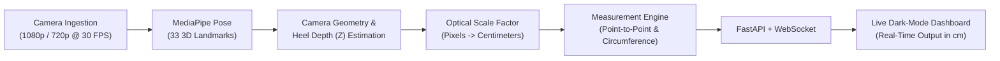

# Smart Mirror Body Measurement System

> **Multi-Disciplinary Project (MDP)**  
> Contact-free, instant dimensional measurement powered by computer vision, automated spatial calibration, and AI-driven landmark analysis.

---

## 👥 Project Team

| Name | Register Number |
| :--- | :--- |
| **Shawn Shaibu Cherian** | `26BCE1820` |
| **Nithin Sandesh S** | `26BCE1821` |
| **Aakash Pon Alagappan** | `26BCE5637` |
| **Dhanaranjani R** | `26BEC1354` |
| **Kavya S** | `26BFT1001` |

---

## 📌 Executive Summary

Selecting correctly fitting apparel remains a challenge in both retail and e-commerce due to brand sizing inconsistencies. Conventional solutions rely either on manual measuring tapes—which require physical contact, staff assistance, and time—or specialized 3D body scanners and LiDAR rigs that cost thousands of dollars.

The **Smart Mirror Body Measurement System** transforms an ordinary mirror into an autonomous, contact-free measurement kiosk. By pairing low-cost monocular webcams with computer vision and pose estimation, the system captures real-world dimensions in centimeters with **zero manual input** from the user.

### System Comparison

| Feature | Traditional Approach | Commercial 3D Scanners | Smart Mirror (Our System) |
| :--- | :--- | :--- | :--- |
| **Method** | Manual measuring tape | Specialized laser/depth sensors | Automated computer vision |
| **Contact** | Physical contact required | Contact-free | **Contact-free** |
| **Hardware Cost** | Low (labor intensive) | Expensive ($1,000s – $10,000s) | **Low cost (~$110 / ₹9,100)** |
| **User Input** | Manual recording | Height / weight entry | **Zero manual input** |
| **Environment** | Private fitting room | Dedicated scanning room | **Open retail kiosk / standard floor** |
| **Storage & Privacy**| Paper logs or manual entry | Cloud 3D mesh storage | **Privacy by design (zero video saved)** |

---

## 📐 System Architecture & Physical Setup

The system combines physical kiosk ergonomics with a dual-camera optical geometry designed to cover the full human body within a compact 1.3 m – 1.5 m focal zone:

```
                  180 cm × 60 cm Mirror
             +------------------------------+
             | [o] Top-Left Camera (1.6 m)  |  --> Head, Shoulders, Arms, Upper Body
             |     (tilted downward/inward) |
             |                              |
             |                              |
             |                              |
             | [o] Bottom-Right Camera      |  --> Waist, Hips, Legs, Feet & Heel Tracking
             |     (0.85 m, tilted upward)  |      (Derives camera-to-user distance Z)
             +------------------------------+
                            |
                 User standing at 1.3–1.5 m
```

- **Top-Left Camera (Height: 1.6 m)**: Tilted slightly downward and inward to capture head, shoulder span, arms, and upper torso landmarks.
- **Bottom-Right Camera (Height: 0.85 m)**: Tilted slightly upward and inward to track waist, hips, legs, and heel positions.
- **Autonomous Heel-Based Scaling**: By tracking the user's feet and heel ground contact against the calibrated camera geometry, the system estimates the distance $Z$ automatically, mapping pixels to centimeters without requiring the user to type in their height or step onto a sensor mat.

---

## 🔬 Vision & Measurement Pipeline



### 1. Point-to-Point Euclidean Measurement
For linear spans (shoulder width, arm length, inseam):
$$D = \sqrt{(x_2 - x_1)^2 + (y_2 - y_1)^2 + (z_2 - z_1)^2}$$

### 2. Circumference Estimation
Cross-sections (chest, waist, and hips) are modeled as ellipses combining lateral width and estimated torso depth:
$$C \approx \pi \left[ 3(a + b) - \sqrt{(3a + b)(a + 3b)} \right]$$

### 3. Privacy by Design
The architecture processes frames strictly in volatile memory (RAM):
$$\text{Camera Frame} \longrightarrow \text{RAM Ingestion} \longrightarrow \text{Feature Extraction} \longrightarrow \text{Measurement Vector} \longrightarrow \text{Frame Discarded}$$
No video stream or user imagery is persisted to disk or transmitted over external networks.

---

## 📦 Monocular Measurement Engine (Current Operational Prototype)

This repository contains the verified, algorithmic foundation of the Smart Mirror: the **Monocular Object Measurement Engine**.

The engine solves precision optical dimensioning on monocular feeds before multi-camera fusion:
- **Reference Fiducial Calibration**: Uses an ArUco Marker ID 0 (`DICT_4X4_50`, 5.0 cm × 5.0 cm) to compute the dynamic scale factor ($S = \text{side}_{\text{cm}} / \text{side}_{\text{px}}$) on each frame.
- **Texture-Immune Outer Contour Segmentation**: Employs bilateral Canny edge detection and morphological closing kernels to extract outer object boundaries while ignoring surface labels, barcodes, and interior prints.
- **Hand & Grasping Suppressor**: Eliminates border-connected skin regions and in-frame gripping fingers so items can be held naturally without corrupting boundary geometry.
- **Temporal EMA Smoothing & Swap Detection**: Applies exponential moving average smoothing to eliminate jitter (within $\pm 0.5$ cm) and detects object swaps to reset tracking state.
- **Save Gate Validation**: Enforces safety checks (Calibration Anchor, Guide Box containment, Clipping avoidance) before recording measurements.
- **Planar Perspective Rectification (ADR 0001)**: Computes planar homography transforms to eliminate foreshortening when held at perspective tilt angles up to $45^\circ$.

---

## 🚀 Getting Started

### Prerequisites
- Python 3.11+
- Built-in webcam or USB camera (macOS / Linux / Windows)

### 1. Installation

```bash
# Clone the repository
git clone git@github.com:wwwrryyy/mdp-project.git
cd mdp-project

# Create and activate virtual environment
python3 -m venv .venv
source .venv/bin/activate  # On Windows: .venv\Scripts\activate

# Install dependencies
pip install -r requirements.txt
```

### 2. Generate the Reference Marker

To print or display the 5.0 cm ArUco reference marker:

```bash
python -m measure_engine.make_marker
```
This generates `marker_id0_5cm.png` with a clean white quiet-zone border at 300 DPI.

### 3. Run the Measurement Engine

```bash
python -m measure_engine
```

#### Controls:
- <kbd>s</kbd> : Save measurement snapshot (appends row to `measurements.csv` and saves annotated frame to `captures/`).
- <kbd>m</kbd> : Toggle binary tracking mask window for diagnostic inspection.
- <kbd>q</kbd> : Exit application.

### 4. Run the Test Suite

```bash
pytest -v
```
The test suite includes 38 automated regression tests covering ArUco scale caching, hand suppression, rotation invariance, EMA filtering, and save gate validation.

---

## 📁 Repository Structure

```
mdp-project/
├── MDP - Smart Mirror.pptx   # Project presentation and architectural review
├── requirements.txt          # Project dependencies (opencv, numpy, pytest)
├── docs/
│   └── adr/
│       └── 0001-perspective-rectification-and-handsfree-capture.md
├── measure_engine/           # Core computer vision measurement package
│   ├── __init__.py
│   ├── __main__.py           # CLI launcher entry point
│   ├── app.py                # Pipeline orchestrator and main event loop
│   ├── config.py             # Configuration parameters and thresholds
│   ├── hud.py                # Dashboard overlays, trackbars, and alerts
│   ├── make_marker.py        # Print-ready ArUco fiducial generator
│   ├── recorder.py           # Snapshot logging and CSV telemetry
│   ├── tracker.py            # Scale caching and EMA dimension smoothing
│   └── vision.py             # OpenCV segmentation, marker detection & measurement
└── tests/                    # Automated regression test suite
    ├── conftest.py           # Synthetic image generators and test fixtures
    ├── test_app.py           # Save gate and CLI integration tests
    ├── test_hand_and_lock.py # Skin and appendage suppression tests
    ├── test_hud.py           # Headless HUD rendering and trackbar tests
    ├── test_recorder.py      # Telemetry schema and snapshot tests
    ├── test_tracker.py       # Scale cache and smoother temporal tests
    └── test_vision.py        # Optical measurement and rotation invariance tests
```

---

## 🔮 Roadmap & Next Milestones

1. **Brand-Specific Sizing Translation**: Automatically map raw body dimensions to brand-specific garment size profiles (e.g. Waist 84 cm $\to$ Brand A: M, Brand B: L, Brand C: 32).
2. **QR Code Direct Export**: Instant transfer of measurement profiles to the user's mobile device via on-screen QR codes without account creation.
3. **Dual-Camera Synchronized Pose Fusion**: Multi-camera WebSocket streaming with MediaPipe 33-landmark 3D reconstruction.
4. **Machine Learning Refinement**: Incorporate statistical human shape models (e.g., SMPL) for enhanced volumetric estimation.
