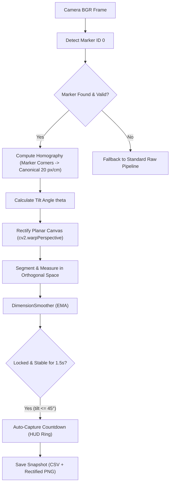

# ADR 0001: Planar Perspective Rectification and Hands-Free Auto-Capture

## 1. Status
**Accepted** (Targeting Implementation in Milestone 2.0)

## 2. Context & Problem Statement
The prototype Monocular Object Measurement Engine accurately measures rigid objects when aligned perpendicularly ($90^\circ \pm 2^\circ$) to the camera's optical axis. However, practical hands-on testing highlighted three critical usability and optical constraints:

1. **Perspective Distortion (Foreshortening)**:
   When an object is tilted toward or away from the lens, perspective projection deforms its rectangular face into a trapezoid. The current algorithm (`minAreaRect` on raw image contours) measures this compressed 2D projection, underestimating real dimensions.
2. **Two-Hand Ergonomics vs Keyboard Shutter**:
   Holding an object steadily in front of a laptop webcam occupies both hands. Reaching for the `'s'` key forces the user to let go or twist, inducing tilt, hand wobble, and sudden motion blur.
3. **Telemetry Completeness**:
   `measurements.csv` currently logs 8 columns but does not record the degree of plane tilt or whether a capture was triggered manually or via stability hold.

---

## 3. Decision Drivers
- **Zero Additional Hardware**: Must run on standard monocular laptop webcams without depth sensors or calibration rigs.
- **Real-Time Performance**: Must maintain $\ge 30$ FPS throughput on Apple Silicon / standard laptop CPUs.
- **Physical Accuracy**: Deliver $\le \pm 0.5$ cm error across tilt angles up to $35^\circ$, and prevent inaccurate saves at extreme angles.
- **Hands-Free Operation**: Enable smooth, deliberate capture without touching the computer keyboard.

---

## 4. Architecture & Engineering Decisions



### 4.1 Planar Perspective Rectification (`cv2.warpPerspective`)
* **Anchor**: Reference Marker ID 0 (`5.0 cm × 5.0 cm`).
* **Transform**: The 4 detected sub-pixel corners of the marker form the source points $\mathbf{P}_{\text{src}}$. The destination points $\mathbf{P}_{\text{dst}}$ are a canonical square of size $100 \times 100\text{ px}$ (pinned scale $S_0 = 20\text{ px/cm}$).
* **Homography Matrix**:
  $$\mathbf{H} = \text{cv2.getPerspectiveTransform}(\mathbf{P}_{\text{src}}, \mathbf{P}_{\text{dst}})$$
* **Pinned-Scale Canvas**:
  Rather than unconstrained warping of the full frame, rectify an expanded canvas centered on the marker coordinate space. All measurements on this canvas have an exact, invariant scale of $20\text{ px/cm}$ ($0.05\text{ cm/px}$), eliminating scale drift.

### 4.2 Tilt Angle Guardrails & Advisory
The angle of the measurement plane relative to the camera optical axis is calculated from the aspect ratio and area distortion of the marker:
$$\theta = \arccos\left(\frac{\text{Area}_{\text{observed}}}{\text{Area}_{\text{canonical}}}\right)$$

* **Tier 1 ($0^\circ \le \theta \le 35^\circ$)**: Nominal accuracy. Planar rectification is applied transparently; HUD displays green `TILT: <theta>°`.
* **Tier 2 ($35^\circ < \theta \le 45^\circ$)**: Acceptable with advisory. Rectification is applied; HUD displays amber `TILT: <theta>° (ADVISORY)`.
* **Tier 3 ($\theta > 45^\circ$)**: Excessive perspective compression and depth-of-field edge softening. Saving is blocked by the Save Gate with `CANNOT SAVE: TILT TOO STEEP (>45°)`.

### 4.3 Picture-in-Picture (PiP) HUD Overlay
* The main display window continues to show the full color camera feed with Guide Box and rotated 3D contour outlines.
* A crisp Picture-in-Picture (PiP) inset (e.g. $240 \times 240\text{ px}$) in the upper-right corner renders the de-skewed orthogonal face with real-time Width × Height callouts, providing instant visual feedback of the de-skewed geometry.

### 4.4 Stability Auto-Capture State Machine
A temporal stability detector monitors measurements inside `measure_engine.tracker`:
* **Trigger Conditions**:
  1. Calibration status is `CALIBRATED`.
  2. Solid target is identified within the Guide Box.
  3. Reading variance stays within $\pm 0.3\text{ cm}$ for $1.5\text{ s}$ ($45$ frames at $30\text{ FPS}$).
  4. Tilt angle $\theta \le 45^\circ$.
* **Visual Shutter**: Renders a circular countdown progress indicator around the centroid crosshair. At $1.5\text{ s}$, triggers snapshot saving with an audio/visual confirmation banner.
* **Manual Override**: The `'s'` key remains active as an instantaneous manual save bypass.

### 4.5 Logging Schema Extensions
Updates `measurements.csv` header with two new non-breaking columns:
```
timestamp,width_cm,height_cm,area_sq_cm,pixel_width,pixel_height,scale_cm_per_px,status,tilt_deg,trigger_type
```
* `tilt_deg`: Estimated plane tilt angle to 1 decimal place (e.g. `14.2`).
* `trigger_type`: Either `AUTO_STABLE` or `MANUAL`.
* `captures/`: Saves the annotated full camera frame as `snapshot_<timestamp>.png` and the de-skewed orthogonal object crop as `rectified_<timestamp>.png`.

---

## 5. Detailed Implementation Blueprint

### Phase 1: Configuration & Models
* **[`measure_engine/config.py`](file:///Users/shawnsc/Projects/mdp-project/measure_engine/config.py)**:
  * Add `enable_perspective_correction: bool = True`
  * Add `canonical_px_per_cm: float = 20.0`
  * Add `max_tilt_deg: float = 45.0`
  * Add `tilt_advisory_deg: float = 35.0`
  * Add `auto_capture_enabled: bool = True`
  * Add `auto_capture_hold_sec: float = 1.5`

### Phase 2: Computer Vision Math (`measure_engine/vision.py`)
* Implement `compute_marker_tilt(marker: Marker, canonical_side_px: float) -> float`:
  Estimates $\theta$ from the homography decomposition / corner ratios.
* Implement `rectify_measurement_plane(frame: np.ndarray, marker: Marker, cfg: Config) -> tuple[np.ndarray, np.ndarray, float]`:
  Returns `(rectified_bgr, homography_matrix, tilt_deg)`.
* Enhance `measure()` to calculate true dimensions directly in canonical rectified coordinate space.

### Phase 3: State Machines (`measure_engine/tracker.py`)
* Extend `DimensionSmoother` to track stability duration:
  * `stable_frames: int`
  * `is_auto_capture_ready: bool`
  * `stability_progress: float` ($0.0 \to 1.0$)

### Phase 4: HUD & UI (`measure_engine/hud.py`)
* Render the Picture-in-Picture (PiP) rectified canvas inset.
* Draw the circular countdown indicator during stability hold.
* Display tilt angle badge (`TILT: xx°`) with dynamic green/amber/red coloring.

### Phase 5: Pipeline & Orchestration (`measure_engine/app.py`)
* Wire rectification and auto-capture into the main frame loop.
* Extend `validate_save_gate` with tilt check (`TILT TOO STEEP`).
* Update `Recorder.save()` with `tilt_deg` and `trigger_type`.

### Phase 6: Automated Synthetic Test Suite
* Create `tests/test_perspective.py`:
  * Generate synthetic box scenes rotated in 3D perspective ($0^\circ, 15^\circ, 30^\circ, 45^\circ$).
  * Verify rectified measurements match ground truth within $\le \pm 0.5\text{ cm}$.
  * Verify auto-capture state transitions and countdown mechanics.

---

## 6. Consequences & Verification
* **Accuracy**: Eliminates perspective foreshortening error; angled boxes at $30^\circ$ maintain $\pm 0.5$ cm accuracy.
* **Usability**: Fully hands-free operation; users simply hold the box steady for 1.5s to capture.
* **Safety**: Prevents corrupted captures at unrecoverable angles ($> 45^\circ$).
* **Compatibility**: 100% backward compatible with existing unit tests and CLI workflow.
